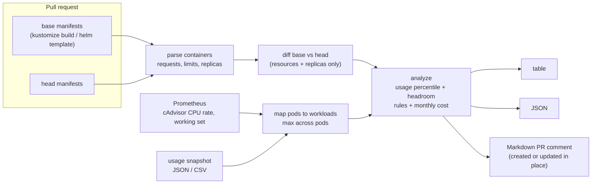

# kube-rightsize-diff

Catch over- and under-provisioned Kubernetes CPU and memory requests **in the pull request that changes them**, before they ship. It compares the requests and limits in your rendered manifests with what the containers actually use (from Prometheus or a snapshot file) and prices the difference.

```console
$ kube-rightsize-diff --base rendered/base.yaml --head rendered/head.yaml --prometheus-url http://prometheus:9090
STATUS  WORKLOAD                         CONTAINER  CHANGE    CPU REQ  CPU USED  CPU SUGGEST  MEM REQ  MEM USED  MEM SUGGEST  MEM LIMIT  PODS  $/MONTH             FINDINGS
RISK    shop/deployment/recommendations  model      added     -        -         -            -        -         -            -          2     $0.00 (new)         missing-cpu-request,missing-memory-request,missing-memory-limit,no-usage-data
RISK    shop/deployment/search           app        modified  100m     350m      420m         512Mi    400Mi     480Mi        768Mi      2     $7.68 (-$13.84)     cpu-request-below-usage
RISK    shop/statefulset/cart-redis      redis      modified  200m     50m       60m          300Mi    280Mi     336Mi        300Mi      1     $5.51 (-$0.64)      cpu-over-provisioned,memory-limit-too-close
WASTE   shop/deployment/checkout         app        modified  2        180m      220m         2Gi      300Mi     360Mi        4Gi        3→4   $209.07 (+$169.87)  cpu-over-provisioned,memory-over-provisioned
INFO    shop/cronjob/nightly-report      report     removed   1        -         -            2Gi      -         -            2Gi        1     n/a                 -
```

(All numbers in this README come from the synthetic fixtures in [`testdata/shop`](testdata/shop), not a real system.)

## Why

Datadog's [State of Cloud Costs](https://www.datadoghq.com/state-of-cloud-costs/) report (AWS cost data from hundreds of organizations, May 2023 to April 2024) found that **83% of container costs were associated with idle resources**. About 54 points of that were idle cluster capacity, and **29 points were "workload idle": resource requests larger than the workloads need**.

That second part is decided in code review. Someone bumps `cpu: "2"` "to be safe" before a launch, or copies a values file from another service, and the reviewer has no idea what the container really uses. Existing right-sizing tools (below) are good at telling you, weeks later, what is oversized in a running cluster. This tool puts the same evidence next to the diff, while the change is still cheap to fix. It also catches the opposite: a request cut below real usage, or a memory limit that leaves the container a few MiB from an OOMKill.

## How it works



1. **Manifests.** Reads rendered YAML or JSON from files, directories or stdin: plain manifests, `kustomize build` output, `helm template` output, or `kubectl get -o yaml` lists. Supports Deployment, StatefulSet, DaemonSet, ReplicaSet, Job, CronJob and Pod. It never needs cluster access. A missing request defaults to the limit, as the API server does.
2. **Diff.** With `--base`, containers are matched by namespace/kind/workload/container. Only containers whose requests, limits or replica count changed are reported. An image bump alone does not count.
3. **Usage.** For each container: CPU at a percentile (default p95) of `rate(container_cpu_usage_seconds_total[5m])`, memory at a percentile (default p99) of `container_memory_working_set_bytes`, over a window (default 7d). Both are two instant queries using `quantile_over_time` over a subquery. Pods are mapped back to workloads by controller naming patterns, and the max across a workload's pods is used. Or skip Prometheus and pass a snapshot file.
4. **Rules.** The suggested request is usage × (1 + headroom), 20% by default, with small floors.

   | Rule | Severity | Fires when |
   |---|---|---|
   | `cpu-request-below-usage` / `memory-request-below-usage` | risk | observed usage is above the request |
   | `memory-limit-too-close` | risk | usage is within 10% of the memory limit (OOMKill) |
   | `cpu-limit-throttling` | risk | usage is within 10% of the CPU limit (CFS throttling) |
   | `missing-cpu-request` / `missing-memory-request` / `missing-memory-limit` | risk | not set |
   | `cpu-over-provisioned` / `memory-over-provisioned` | waste | request is above 1.5× the suggestion **and** the excess costs at least $1/month |
   | `no-usage-data` | info | new container, or nothing in the window |

5. **Cost.** Requested cost per month = pods × 730 h × (vCPU × price per vCPU-hour + GiB × price per GiB-hour). The default prices ($0.0316 per vCPU-hour, $0.0042 per GiB-hour) are **example values only**, there so the tool prints something out of the box. Set your own blended rates. Jobs and CronJobs get no monthly figure because they run intermittently. DaemonSets are priced per node unless you pass `--daemonset-nodes`.

## Usage

### CLI

```bash
go install github.com/gratycodes/kube-rightsize-diff/cmd/kube-rightsize-diff@latest

# Whole-app review against a snapshot (no cluster, no Prometheus)
kustomize build overlays/prod | kube-rightsize-diff --head - --usage usage.json

# PR-style diff against Prometheus, as Markdown
kube-rightsize-diff \
  --base base.yaml --head head.yaml \
  --prometheus-url https://prometheus.example.internal --window 14d \
  --cpu-percentile 0.95 --memory-percentile 0.99 \
  --price-vcpu-hour 0.031 --price-gib-hour 0.004 \
  --format markdown --fail-on risk
```

| Flag | Default | |
|---|---|---|
| `--head`, `--base` | | files, directories or `-`; repeatable. `--base` turns on diff mode |
| `--usage` | | `.json` or `.csv` snapshot |
| `--prometheus-url` | | bearer token from `$PROMETHEUS_TOKEN`; `--prometheus-selector 'cluster="prod"'` adds label matchers |
| `--window`, `--resolution`, `--rate-interval` | `7d`, `1m`, `5m` | Prometheus durations |
| `--cpu-percentile`, `--memory-percentile` | `0.95`, `0.99` | |
| `--cpu-headroom`, `--memory-headroom` | `0.2` | |
| `--over-factor`, `--min-waste-usd`, `--limit-margin` | `1.5`, `1`, `0.1` | rule thresholds |
| `--format` | `table` | `table`, `json`, `markdown` |
| `--fail-on` | `none` | exit 2 on `risk`, `waste` or `any` finding |
| `--max-cost-increase` | `-1` | exit 2 if requested cost rises more than N USD/month |

Snapshot format (CSV works too, with columns `namespace,kind,workload,container,cpu,memory`, and `kind` may be empty):

```json
{
  "source": "prod export 2026-10-01",
  "cpu_percentile": 0.95, "memory_percentile": 0.99, "window": "7d",
  "containers": [
    {"namespace": "shop", "kind": "Deployment", "workload": "checkout", "container": "app", "cpu": "180m", "memory": "300Mi"}
  ]
}
```

### GitHub Action

The action is composite and builds the CLI from source with `setup-go`, with no Docker. It posts one PR comment and updates it on later pushes. Rendering base and head is up to you, because only your repo knows how. See [`docs/example-workflow.yml`](docs/example-workflow.yml) for a Kustomize setup that uses `git worktree`.

```yaml
permissions:
  contents: read
  pull-requests: write
steps:
  # ...render base.yaml and head.yaml...
  - uses: gratycodes/kube-rightsize-diff@main
    with:
      head: rendered/head.yaml
      base: rendered/base.yaml
      prometheus-url: ${{ vars.PROMETHEUS_URL }}
      prometheus-token: ${{ secrets.PROMETHEUS_TOKEN }}
      fail-on: risk            # optional gate
      max-cost-increase: "500" # optional gate, USD/month
```

Outputs: `risks`, `wastes`, `monthly-delta-usd`, `report-json`. Inputs reach the script through environment variables, never `${{ }}` interpolation, so a crafted value cannot inject shell commands.

### Sample PR comment

This is the comment for the fixture PR in `testdata/shop` (bump `checkout` for a sale, cut `search` CPU, tighten `cart-redis` memory, add a service with no resources, delete a CronJob):

> ### Kubernetes resource requests check
>
> **3 at risk · 2 over-provisioned** across 5 changed containers. Requested cost **$66.87 → $222.26/month (+$155.39)**. Trimming requests that exceed the suggestions saves about **$187.88/month**.
>
> | Status | Workload | Container | CPU request (used → suggested) | Memory request (used → suggested) | Memory limit | Pods | $/month |
> |---|---|---|---|---|---|---|---|
> | 🔴 risk | `shop/deployment/recommendations` added | `model` | - (no usage data) | - (no usage data) | - | 2 | $0.00 (new) |
> | 🔴 risk | `shop/deployment/search` modified | `app` | 100m (350m → 420m) | 512Mi (400Mi → 480Mi) | 768Mi | 2 | $7.68 (-$13.84) |
> | 🔴 risk | `shop/statefulset/cart-redis` modified | `redis` | 200m (50m → 60m) | 300Mi (280Mi → 336Mi) | 300Mi | 1 | $5.51 (-$0.64) |
> | 🟡 waste | `shop/deployment/checkout` modified | `app` | 2 (180m → 220m) | 2Gi (300Mi → 360Mi) | 4Gi | 3→4 | $209.07 (+$169.87) |
> | ⚪ info | `shop/cronjob/nightly-report` removed | `report` | 1 | 2Gi | 2Gi | 1 | n/a |
>
> <details><summary>9 findings</summary> … one line per rule, e.g. "observed memory 280Mi is 93% of the 300Mi limit; OOMKill risk on the next spike" …</details>
>
> <sub>2 unchanged containers not shown. Usage: CPU p95 / memory p99 over 7d from synthetic fixture, not real telemetry. …</sub>

The full output is in [`internal/report/testdata/shop-diff.md`](internal/report/testdata/shop-diff.md).

## How it compares

These are good tools. This one does a narrower job at a different moment.

| | When it runs | Input | Output | Notes |
|---|---|---|---|---|
| **[KRR](https://github.com/robusta-dev/krr)** (Robusta) | on demand, against a live cluster | Prometheus + cluster API | recommendations for everything running | The closest relative and more mature. Its default strategy is CPU p95 with no limit, memory max + 15%. It is better for a full-cluster audit, and doesn't look at a PR diff. |
| **[Goldilocks](https://github.com/FairwindsOps/goldilocks)** (Fairwinds) | continuously, in cluster | VPA objects in recommend mode | dashboard per namespace | Needs VPA installed and an in-cluster controller. |
| **[VPA recommender](https://github.com/kubernetes/autoscaler/tree/master/vertical-pod-autoscaler)** | continuously, in cluster | metrics-server / its own histograms | VPA status, optionally applied | Can resize pods itself. Don't let VPA and HPA act on the same CPU/memory metric. |
| **[Kubecost](https://www.kubecost.com/)** / OpenCost | continuously, in cluster | cluster + billing data | cost allocation, savings reports | Real prices and full cost allocation. A platform, not a review-time check. |
| **kube-rightsize-diff** | **in the pull request** | **rendered base/head manifests** + Prometheus or a snapshot | PR comment / JSON / table, with an optional gate | No in-cluster component and no kubeconfig. Only reports what the PR changes. Simple, explainable rules, and much less mature than the tools above. |

A sensible setup uses one of the in-cluster tools to fix what's already running, and this one to stop new drift in review.

## Limitations

- **Usage history must exist.** New workloads only get the static checks. A renamed Deployment looks new. A short window, or one that doesn't cover month-end or a sale, gives low numbers. Pick `--window` deliberately.
- **Bursty workloads.** A p95 over 5-minute rates smooths out short spikes. Latency-sensitive services that burst for seconds may need more than the suggestion. Raise the percentile or headroom, or use p99 for CPU too. Memory uses p99 of the working set by default, not the max.
- **HPA and VPA.** With an HPA on CPU utilization, the request is the scaling target's denominator: lowering it makes the HPA add pods, so the saving partly comes back as replicas. Cost uses the `replicas` in the manifest, not what the HPA actually runs. If VPA manages a workload, its recommendations win at runtime and this tool's suggestion is only a second opinion.
- **Pod-to-workload mapping is by name.** Without kube-state-metrics' owner labels, pods are matched by controller naming patterns (`name-<hash>-<id>`, `name-<ordinal>`, …). Unusual naming, or two workloads whose names are prefixes of each other with odd suffixes, can mismatch. Using `kube_pod_owner` is on the roadmap.
- **One cluster at a time.** Use `--prometheus-selector 'cluster="prod"'` when a Prometheus covers several. Usage from staging says little about production.
- **Costs are list-price style estimates of requests.** No discounts, spot, bin-packing waste, GPUs or storage. They say how much a change moves the bill, not what the bill is.
- **Your CI must reach Prometheus.** Usually that means a self-hosted runner, a gateway, or exporting a snapshot on a schedule and committing it.
- Init containers are ignored unless you pass `--include-init-containers`. Sidecars injected at admission time (for example Istio) are not in rendered manifests, so they are not checked.

## Development

```bash
go test -race ./...                     # unit, golden-file and CLI tests
go test ./internal/report -update       # refresh golden files, then review the diff
golangci-lint run ./...
```

CI runs `go vet`, `golangci-lint`, `go test -race`, a self-test of the action on the fixtures, and an end-to-end job. The end-to-end job creates a kind cluster, deploys a minimal Prometheus that scrapes kubelet cAdvisor, and runs two busybox workloads: one idle, one in a busy loop. It waits for about two minutes of real data, then checks that a PR raising the idle one to 1 CPU is flagged as waste and one cutting the busy one to 10m is flagged as risk ([`e2e/run.sh`](e2e/run.sh)).

Layout: `internal/manifest` (parse and diff), `internal/usage` (snapshots and Prometheus), `internal/analyze` (rules and cost), `internal/report` (renderers), `cmd/kube-rightsize-diff`, `action.yml` plus `scripts/action-run.sh`.

## Name

I first planned to call this `kube-requests-check`. GoogleCloudPlatform's `kubernetes-engine-samples` already ships a script named `kube-requests-checker` that lists containers without requests. To avoid confusion I picked a name that says what's different here: it right-sizes the **diff**.

## License

MIT © Gratus Antin
